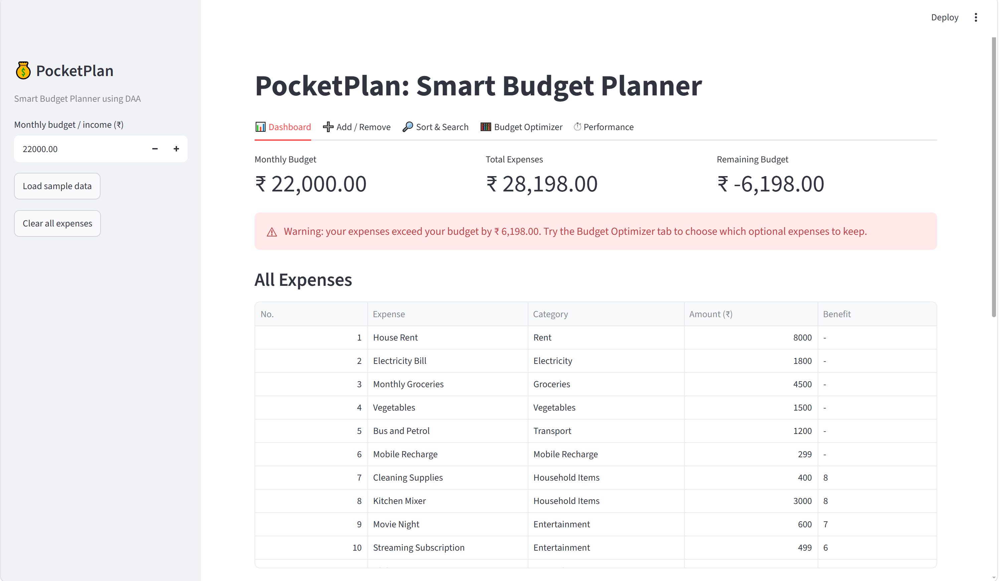
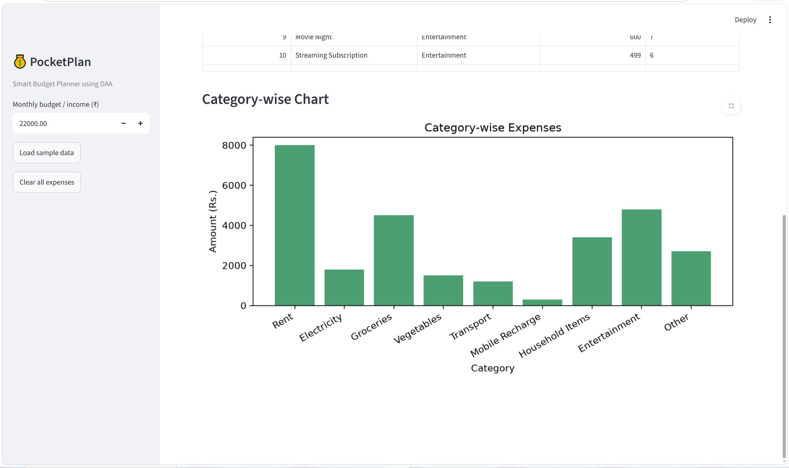
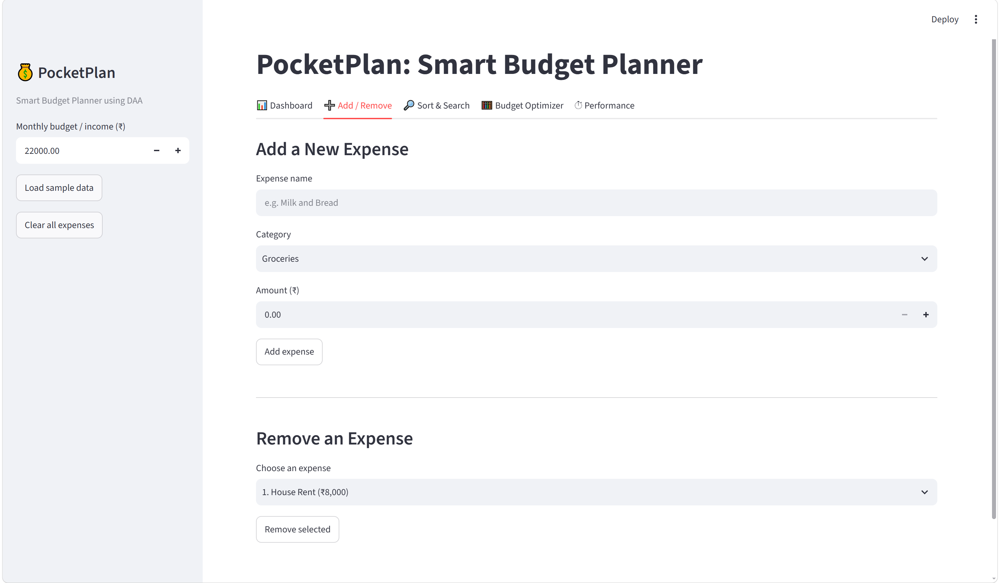
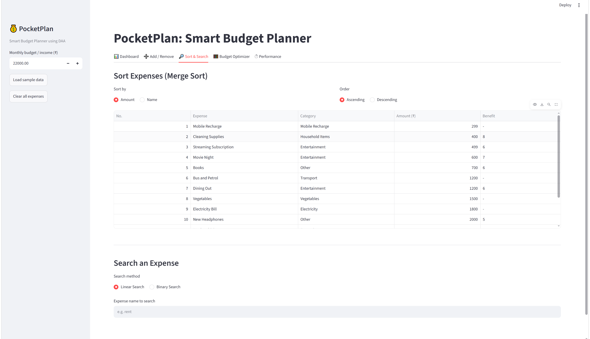
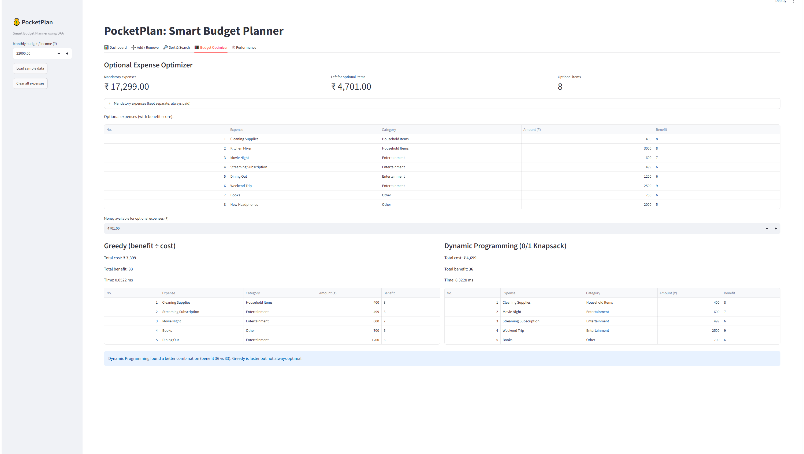

# PocketPlan - Smart Budget Planner Using DAA

**A Python + Streamlit application that applies Design and Analysis of Algorithms (DAA) concepts to real-world household budgeting.**

PocketPlan helps users track monthly expenses, monitor their remaining budget, search and sort expense records, and optimize optional spending using classic algorithmic techniques.

The project demonstrates how fundamental computer science algorithms can be implemented and integrated into an interactive application.

---

## Table of Contents

- [Overview](#overview)
- [Features](#features)
- [Tech Stack](#tech-stack)
- [Application Modules](#application-modules)
- [Algorithms Implemented](#algorithms-implemented)
- [Project Structure](#project-structure)
- [Getting Started](#getting-started)
- [How to Use](#how-to-use)
- [Testing](#testing)
- [Performance Analysis](#performance-analysis)
- [Design Decisions and Limitations](#design-decisions-and-limitations)
- [Future Improvements](#future-improvements)
- [Learning Outcomes](#learning-outcomes)

---

## Overview

Managing a monthly budget involves more than calculating expenses. Users must distinguish essential costs from optional purchases, locate specific expenses, organize spending records, and decide which optional items fit within a limited budget.

PocketPlan addresses these challenges through a lightweight budgeting interface powered by algorithms from Design and Analysis of Algorithms.

### Why PocketPlan?

- Converts theoretical DAA concepts into practical use cases.
- Demonstrates searching, sorting, greedy optimization, and dynamic programming.
- Provides an interactive interface using Streamlit.
- Compares algorithm execution times for different input sizes.
- Illustrates the trade-off between a fast heuristic and an optimal solution.

## Features

- **Expense Management:** Add and remove household expense records.
- **Budget Tracking:** Calculate total expenses, remaining balance, and category-wise spending.
- **Interactive Dashboard:** Display budget summaries, expense tables, and visualizations.
- **Linear Search:** Search expense records sequentially.
- **Binary Search:** Perform exact-match searches on appropriately sorted data.
- **Merge Sort:** Sort records using a custom divide-and-conquer algorithm.
- **Greedy Optimization:** Select optional items according to their benefit-to-cost ratio.
- **Dynamic Programming:** Solve the 0/1 Knapsack problem to maximize total benefit within a budget.
- **Performance Analysis:** Measure algorithm execution time using Python's `time.perf_counter()`.
- **Algorithm Testing:** Run tests for the implemented algorithm functions.

## Tech Stack


| Technology | Purpose |
|---|---|
| Python | Application logic and algorithm implementations |
| Streamlit | Interactive web interface |
| Matplotlib | Budget and performance visualizations |
| NumPy | Numerical utilities, if used by the current implementation |
| `time.perf_counter()` | Measuring algorithm execution time |

## Application Modules

PocketPlan organizes its functionality into five main tabs.

| Module | Description |
|---|---|
| Dashboard | View budget summaries, remaining balance, and category-wise spending |
| Add / Remove | Add and remove household expense records |
| Sort & Search | Search expenses and sort records |
| Budget Optimizer | Compare Greedy and Dynamic Programming approaches |
| Performance | Benchmark searching, sorting, and optimization algorithms |

## Algorithms Implemented

PocketPlan demonstrates five core algorithmic techniques and their applications to expense management and budget optimization.

### 1. Linear Search

**Time Complexity:** Best case `O(1)`, worst case `O(n)`

Linear Search checks elements one by one until it finds a matching record or reaches the end of the list.

**Application in PocketPlan:**
- Searches expense records without requiring sorted input.
- Supports the documented partial-name search behavior.
- Demonstrates straightforward searching on an unsorted collection.

### 2. Binary Search

**Time Complexity:** `O(log n)`  
**Prerequisite:** Input must be sorted according to the search key.

Binary Search compares the target with the middle element and repeatedly eliminates half of the remaining search range.

**Application in PocketPlan:**
- Performs exact-match searches on sorted data.
- Demonstrates efficient searching through repeated halving.
- Highlights why algorithm prerequisites matter.

Binary Search should not be applied to unsorted data without first sorting it.

### 3. Merge Sort

**Time Complexity:** `O(n log n)` in the best, average, and worst cases  
**Auxiliary Space:** `O(n)`

Merge Sort uses the divide-and-conquer technique:

1. Divide the list into smaller halves.
2. Recursively sort each half.
3. Merge the sorted halves into a single sorted list.

**Application in PocketPlan:**
- Sorts expense records using a custom algorithm.
- Demonstrates recursion and divide and conquer.
- Provides a comparison with Python's built-in `sorted()` function.

### 4. Greedy Algorithm

**Typical Time Complexity:** `O(n log n)` when sorting candidates by benefit-to-cost ratio.

The Greedy approach ranks optional expenses according to their benefit per rupee and selects affordable items in that order.

**Application in PocketPlan:**
- Prioritizes items with a higher benefit-to-cost ratio.
- Provides a fast and intuitive budget allocation strategy.
- Demonstrates locally optimal decision-making.

**Limitation:** A locally optimal choice does not always produce the globally optimal combination for the 0/1 Knapsack problem.

### 5. Dynamic Programming — 0/1 Knapsack

**Time Complexity:** `O(nW)`  
**Space Complexity:** `O(nW)` for a conventional two-dimensional DP table.

The 0/1 Knapsack problem selects items with individual costs and benefits while ensuring that the total cost does not exceed the available budget.

Each item can either be selected once or skipped.

The recurrence relation is:

\[
DP[i][w] =
\begin{cases}
DP[i-1][w], & c_i > w \\
\max(DP[i-1][w], b_i + DP[i-1][w-c_i]), & c_i \leq w
\end{cases}
\]

Where:

- `i` represents the number of items considered.
- `w` represents the available budget capacity.
- `c_i` represents the cost of item `i`.
- `b_i` represents the benefit of item `i`.

**Application in PocketPlan:**
- Evaluates alternative combinations of optional expenses.
- Maximizes total benefit within the available budget.
- Demonstrates optimal substructure and overlapping subproblems.

Unlike the Greedy approach, Dynamic Programming finds an optimal solution for the modeled 0/1 Knapsack problem, assuming the implementation correctly models the inputs and constraints.

**Important:** The `O(nW)` complexity is pseudo-polynomial because it depends on the numeric budget capacity, not just the number of items.

## Project Structure

```text
PocketPlan/
├── app.py
├── calculations.py
├── optimization.py
├── performance.py
├── sample_data.py
├── searching.py
├── sorting.py
├── test_algorithms.py
├── requirements.txt
├── .gitignore
└── README.md
```

### File Responsibilities

| File | Responsibility |
|---|---|
| `app.py` | Streamlit interface, application interactions, tables, and charts |
| `calculations.py` | Expense totals, remaining budget, category totals, and expense splitting |
| `optimization.py` | Greedy allocation and 0/1 Knapsack |
| `performance.py` | Algorithm runtime measurements and comparisons |
| `sample_data.py` | Sample household expense records |
| `searching.py` | Linear Search and Binary Search |
| `sorting.py` | Merge Sort and sorting helpers |
| `test_algorithms.py` | Tests for algorithm functions |
| `requirements.txt` | Python dependency list |

## Getting Started

Follow these steps to run PocketPlan locally on Windows.

### Prerequisites

- Python 3.10 or later
- Visual Studio Code or another Python-compatible editor
- Git, if cloning the repository

### 1. Clone the Repository

Replace the placeholder below with your actual GitHub repository URL.

```bash
git clone <YOUR_GITHUB_REPOSITORY_URL>
cd PocketPlan
```

Alternatively, download the repository as a ZIP file and open the extracted project folder in VS Code.

### 2. Create a Virtual Environment

Open a terminal in the project directory.

```powershell
python -m venv .venv
```

Activate the environment in PowerShell:

```powershell
.\.venv\Scripts\Activate.ps1
```

If PowerShell blocks activation, use Command Prompt instead:

```bat
.venv\Scripts\activate.bat
```

### 3. Install Dependencies

```bash
python -m pip install --upgrade pip
python -m pip install -r requirements.txt
```

### 4. Run the Tests

```bash
python test_algorithms.py
```

The existing project documentation identifies the expected success message as:

```text
All tests passed!
```

Verify this against the current implementation before relying on the result.

### 5. Launch the Application

```bash
python -m streamlit run app.py
```

Streamlit will provide a local URL, typically:

```text
http://localhost:8501
```

Open the URL in your browser to access PocketPlan.

To stop the application, press `Ctrl + C` in the terminal.

## How to Use

1. **Open the Dashboard:** Review expense totals, the remaining balance, and category-wise spending.
2. **Manage Expenses:** Add or remove household expenses.
3. **Search Records:** Use Linear Search or Binary Search according to the selected search behavior.
4. **Sort Expenses:** Organize records using the available sorting functionality.
5. **Optimize Your Budget:** Compare the items selected by the Greedy and Dynamic Programming approaches.
6. **Analyze Performance:** Run the available benchmarks to observe execution time as input size changes.

The application uses sample expenses for demonstration. It does not require a bank connection or real financial account.

## Testing

The project includes `test_algorithms.py` for validating the implemented algorithms.

Recommended validation cases include:

| Test Case | Expected Behavior |
|---|---|
| Search for an existing expense | Matching record is found |
| Search for a missing expense | No matching record is returned |
| Binary Search on sorted input | Correct exact-match result |
| Merge Sort on an unsorted list | Elements are returned in sorted order |
| Budget below every optional item cost | No optional item is selected |
| Optimization under a limited budget | Total selected cost does not exceed the budget |
| Empty expense list | Functions handle empty input without crashing |

Run the test suite with:

```bash
python test_algorithms.py
```

These are recommended validation cases; confirm which cases are covered by the current test file.

## Performance Analysis

PocketPlan includes a performance module to compare algorithm execution times across different input sizes.

The application uses Python's `time.perf_counter()` to measure elapsed time.

### What the benchmarks demonstrate

- Linear Search may examine up to `n` records.
- Binary Search repeatedly halves a sorted search range.
- Merge Sort has `O(n log n)` time complexity.
- Python's built-in `sorted()` can outperform a custom Python Merge Sort implementation because it uses optimized native code.
- Greedy optimization and Dynamic Programming differ in both computational cost and solution quality.

### Interpreting results correctly

Benchmark measurements depend on the machine, Python version, input data, and measurement overhead.

For more reliable comparisons:

1. Use consistent input datasets.
2. Test multiple input sizes.
3. Repeat each measurement.
4. Compare representative measurements rather than a single run.
5. Distinguish theoretical complexity from measured runtime.

The sample performance results in earlier documentation are illustrative and should not be treated as universal benchmark results.

## Design Decisions and Limitations

PocketPlan is an educational prototype focused on algorithm implementation and demonstration.

- **In-memory storage:** Expense data is stored in Streamlit session state rather than a persistent database. Data may reset when the session is lost or the application restarts.
- **No authentication:** User accounts and access control are not implemented.
- **No bank integration:** The application does not automatically import transactions or connect to financial institutions.
- **Sample data:** Included expenses are intended for demonstration rather than representing actual household spending.
- **Knapsack scalability:** The Dynamic Programming table grows with the budget capacity, so the implementation limits its size for practicality.
- **Greedy limitations:** Ranking by benefit per rupee does not guarantee an optimal 0/1 Knapsack solution.
- **Benchmark variability:** Execution times may differ between machines and runs.

## Future Improvements

Potential enhancements for future versions include:

- Persistent expense storage using SQLite.
- Expense export to CSV.
- Custom monthly budgets and configurable expense categories.
- More extensive automated testing and continuous integration.
- Repeated benchmarks with summary statistics.
- An optional deployed demonstration with clearly documented privacy and persistence behavior.

These are proposed improvements, not features claimed to exist in the current version.

## Learning Outcomes

Developing PocketPlan provides practical experience with:

- Translating a real-world problem into algorithmic subproblems.
- Implementing searching and sorting algorithms in Python.
- Applying Greedy algorithms and Dynamic Programming.
- Understanding time and space complexity.
- Measuring and interpreting algorithm performance.
- Building an interactive application using Streamlit.
- Organizing code into reusable Python modules.
- Testing algorithm behavior across different inputs.


## Application Preview

Explore the different modules of PocketPlan through the screenshots below.

### 1. Dashboard

View your monthly budget, total expenses, remaining balance, and household expense records.




### 2. Add / Remove Expenses

Manage household expense records and update your budget calculations.



### 3. Sort & Search

Explore expense searching and sorting using fundamental DAA algorithms.



### 4. Budget Optimizer

Compare Greedy and Dynamic Programming approaches for selecting optional expenses within a budget.




## 👨‍💻 Author

**Abhishek**

- GitHub: [@iabhishek765](https://github.com/iabhishek765)
- Project: [PocketPlan](https://github.com/iabhishek765/PocketPlan)

## Acknowledgements

PocketPlan was developed as a practical project to demonstrate Design and Analysis of Algorithms concepts through an interactive household budgeting application.

---

**PocketPlan — Plan smarter. Spend consciously. Understand the algorithms behind every decision.**
